# Zepnest Customer App: Design Reference

Everything you need to reproduce the look of the Zepnest customer app: every icon (with its exact source glyph), the brand marks, the illustrations, the colour and type tokens, and the small component recipes that hold them together.

- **Source:** `customer-app/index.html` in the Zepnest project (a single-file React prototype of the customer app, 39 screens).
- **Assets:** every image referenced below is in [`assets/`](assets/) in this repo. Copy them directly.

---

## Contents

1. [How the icon system works](#1-how-the-icon-system-works)
2. [Drop-in code to reproduce it](#2-drop-in-code-to-reproduce-it)
3. [Full icon catalogue (66 icons)](#3-full-icon-catalogue)
4. [Icons outside the wrapper](#4-icons-outside-the-wrapper)
5. [Icon sizing, colour and container rules](#5-icon-sizing-colour-and-container-rules)
6. [Brand marks and app icons](#6-brand-marks-and-app-icons)
7. [Category illustrations (3D icons)](#7-category-illustrations-3d-icons)
8. [Service card photography](#8-service-card-photography)
9. [Design tokens](#9-design-tokens)
10. [Component recipes](#10-component-recipes)
11. [Gotchas](#11-gotchas)
12. [Licences](#12-licences)

---

## 1. How the icon system works

**Read this first, because the code is misleading.** The source comment says `Icons: Lucide React 0.263`, and every call site uses Lucide-style names (`<LIcon name="ShieldCheck" />`). But **no Lucide is loaded**. Every icon actually renders as a **Font Awesome 6.4.0 Free, Solid** glyph through a lookup table (`FA_MAP`).

So what you see on screen is **filled, solid Font Awesome icons**, not Lucide's thin outline icons. If you want the same look, use Font Awesome Solid. If you swap in real Lucide icons, the app will look noticeably lighter and thinner.

| Fact | Value |
|---|---|
| Icon library actually rendered | Font Awesome **6.4.0 Free**, style **Solid** (`fa-solid`) |
| Loaded from | `https://cdnjs.cloudflare.com/ajax/libs/font-awesome/6.4.0/css/all.min.css` |
| Wrapper component | `LIcon({ name, size = 20, color = 'currentColor', strokeWidth, style })` |
| Glyph size | `font-size = size × 0.88`, inside a box `size` px wide, centred |
| `strokeWidth` prop | **Ignored.** It is a leftover from the Lucide API; FA is a font with no stroke |
| Unknown name fallback | `fa-circle` (a solid dot) |
| Default colour | `currentColor` |

---

## 2. Drop-in code to reproduce it

```html
<link rel="stylesheet"
      href="https://cdnjs.cloudflare.com/ajax/libs/font-awesome/6.4.0/css/all.min.css">
```

```jsx
const FA_MAP = {
  ArrowLeft:    'fa-arrow-left',    Home:         'fa-house',
  Building2:    'fa-building',      CalendarDays: 'fa-calendar-days',
  Tag:          'fa-tag',           User:         'fa-user',
  AlertCircle:  'fa-circle-exclamation', AlertTriangle:'fa-triangle-exclamation',
  CheckCircle:  'fa-circle-check',  CheckCircle2: 'fa-circle-check',
  CreditCard:   'fa-credit-card',   Banknote:     'fa-money-bill-wave',
  Link:         'fa-link',          Check:        'fa-check',
  Phone:        'fa-phone',         UserCheck:    'fa-user-check',
  Navigation:   'fa-location-arrow',Bell:         'fa-bell',
  Star:         'fa-star',          Share2:       'fa-share-nodes',
  ThumbsUp:     'fa-thumbs-up',     Frown:        'fa-face-frown',
  Plus:         'fa-plus',          Archive:      'fa-box-archive',
  CalendarCheck:'fa-calendar-check',FileImage:    'fa-file-image',
  ShieldCheck:  'fa-shield-halved', ChevronRight: 'fa-chevron-right',
  ChevronDown:  'fa-chevron-down',  MapPin:       'fa-map-pin',
  Edit2:        'fa-pencil',        Trash2:       'fa-trash',
  Info:         'fa-circle-info',   LogOut:       'fa-right-from-bracket',
  HelpCircle:   'fa-circle-question', FileText:   'fa-file-lines',
  Shield:       'fa-shield',        Lock:         'fa-lock',
  Receipt:      'fa-receipt',       ClipboardList:'fa-clipboard-list',
  Search:       'fa-magnifying-glass', Clock:     'fa-clock',
  RotateCcw:    'fa-arrow-rotate-left', Play:     'fa-play',
  ExternalLink: 'fa-arrow-up-right-from-square', Minus: 'fa-minus',
  X:            'fa-xmark',         Camera:       'fa-camera',
  Mic:          'fa-microphone',    Video:        'fa-video',
  ImageIcon:    'fa-image',         Paintbrush:   'fa-paint-roller',
  Zap:          'fa-bolt',          Droplet:      'fa-droplet',
  Tool:         'fa-screwdriver-wrench', Sparkles: 'fa-wand-magic-sparkles',
  Wifi:         'fa-wifi',
  Scissors:     'fa-scissors',      Hand:         'fa-hand',
  Smile:        'fa-face-smile',    Wind:         'fa-wind',
  Percent:      'fa-percent',       Gift:         'fa-gift',
  Wrench:       'fa-wrench',        Package:      'fa-box',
  Grid:         'fa-table-cells',
};

function LIcon({ name, size = 20, color = 'currentColor', style }) {
  const fa = FA_MAP[name] || 'fa-circle';
  return (
    <i className={'fa-solid ' + fa}
       style={{ fontSize: size * 0.88, color, lineHeight: 1, display: 'inline-block',
                width: size, textAlign: 'center', flexShrink: 0, ...style }} />
  );
}
```

**React Native / Expo equivalent:** `@expo/vector-icons` ships `FontAwesome6` with the same glyph names minus the `fa-` prefix, for example `<FontAwesome6 name="shield-halved" solid size={size * 0.88} color={color} />`.

---

## 3. Full icon catalogue

All 66 names in the map. "FA glyph" links to the icon on fontawesome.com (Solid style). Sizes are in px (the `size` prop, so the glyph is 88% of that).

### 3.1 Navigation and chrome

| App name | FA glyph | Where it appears | Size / colour |
|---|---|---|---|
| `Home` | [`fa-house`](https://fontawesome.com/icons/house?s=solid) | Bottom nav → **Home** tab | 20 · active `#1A1A1A`, inactive `rgba(20,20,20,.45)` |
| `CalendarDays` | [`fa-calendar-days`](https://fontawesome.com/icons/calendar-days?s=solid) | Bottom nav → **Bookings** tab; "Book a slot" CTA on Hourly & Project service screens | 20 nav · 16 white on CTA |
| `Building2` | [`fa-building`](https://fontawesome.com/icons/building?s=solid) | Bottom nav → **Property** tab; Property "coming soon" hero; "Work" address in location sheet | 20 nav · 52 hero · 16 sheet |
| `Tag` | [`fa-tag`](https://fontawesome.com/icons/tag?s=solid) | Bottom nav → **Offers** tab; Offers "coming soon" hero; offer notification; cart coupon row | 20 nav · 52 hero (accent `#E88B1A`) · 16 cart |
| `ArrowLeft` | [`fa-arrow-left`](https://fontawesome.com/icons/arrow-left?s=solid) | Every back button: standard header, service hero, category list header | 19 in header · 15 on photo hero |
| `ChevronRight` | [`fa-chevron-right`](https://fontawesome.com/icons/chevron-right?s=solid) | Row disclosure on Profile menu, payment "add card", cart coupon, alert demo list; inside dark CTAs | 13–16 · `#9E9E9E` on rows, white in CTAs |
| `ChevronDown` | [`fa-chevron-down`](https://fontawesome.com/icons/chevron-down?s=solid) | Home address dropdown; accordions (service details, attachments, bill details); "view details" on catalog cards | 12–16 |
| `X` | [`fa-xmark`](https://fontawesome.com/icons/xmark?s=solid) | Close location sheet; remove attachment chip; "not included" list item | 14 · 9 white on chip · 10 red `#C62828` |
| `Search` | [`fa-magnifying-glass`](https://fontawesome.com/icons/magnifying-glass?s=solid) | Home search bar; location sheet search; category list header | 15–16 · hint `#9E9E9E` in fields |
| `ExternalLink` | [`fa-arrow-up-right-from-square`](https://fontawesome.com/icons/arrow-up-right-from-square?s=solid) | "Watch how it works" row; invoice link on payment | 14 hint · 11 primary |
| `User` | [`fa-user`](https://fontawesome.com/icons/user?s=solid) | Profile button, top-right of Home header | 22 · white |
| `MapPin` | [`fa-map-pin`](https://fontawesome.com/icons/map-pin?s=solid) | Home header address; Saved Addresses (profile menu); address cards; location sheet "Home" address | 14 white 85% on header · 15–18 elsewhere |
| `Navigation` | [`fa-location-arrow`](https://fontawesome.com/icons/location-arrow?s=solid) | "Use current location" in location sheet; "Technician en route" notification | 16 primary · 20 accent |

### 3.2 Actions

| App name | FA glyph | Where it appears | Size / colour |
|---|---|---|---|
| `Plus` | [`fa-plus`](https://fontawesome.com/icons/plus?s=solid) | Quantity stepper "+", add address, add attachment tile, add card, cart "add more" | 10–13 white in steppers · 18–22 elsewhere |
| `Minus` | [`fa-minus`](https://fontawesome.com/icons/minus?s=solid) | Quantity stepper "−" | 10–13 white |
| `Check` | [`fa-check`](https://fontawesome.com/icons/check?s=solid) | Booking confirmed hero; order progress tracker dots; selected address; "included" list ticks; mini checkbox | 46 green in 88 px circle · 8–11 in lists |
| `Edit2` | [`fa-pencil`](https://fontawesome.com/icons/pencil?s=solid) | Edit profile (on dark profile header); edit address | 16 · white 80% / `#757575` |
| `Trash2` | [`fa-trash`](https://fontawesome.com/icons/trash?s=solid) | Delete address; "Delete Account" menu row; remove-address & delete-account alerts | 16–18 · red `#C62828` |
| `Share2` | [`fa-share-nodes`](https://fontawesome.com/icons/share-nodes?s=solid) | Share on service hero, category list header, post-rating CTA | 14–16 |
| `LogOut` | [`fa-right-from-bracket`](https://fontawesome.com/icons/right-from-bracket?s=solid) | "Log Out" menu row and its alert | 18 red row · 30 grey in alert |
| `Phone` | [`fa-phone`](https://fontawesome.com/icons/phone?s=solid) | "Call technician" on Order Detail | 14 primary |
| `Play` | [`fa-play`](https://fontawesome.com/icons/play?s=solid) | "Watch how it works" video tile | 12 white on red `#E24B4A` 30×30 r8 tile |
| `RotateCcw` | [`fa-arrow-rotate-left`](https://fontawesome.com/icons/arrow-rotate-left?s=solid) | Trust bar: "Free reschedule" / "₹149 adjusted" | 12 grey |
| `Link` | [`fa-link`](https://fontawesome.com/icons/link?s=solid) | *Mapped but unused* | n/a |
| `Grid` | [`fa-table-cells`](https://fontawesome.com/icons/table-cells?s=solid) | *Mapped but unused* | n/a |

### 3.3 Status and feedback

| App name | FA glyph | Where it appears | Size / colour |
|---|---|---|---|
| `Info` | [`fa-circle-info`](https://fontawesome.com/icons/circle-info?s=solid) | Yellow warning notes (address, hourly service, checkout); project step hints | 14–15 warning `#B07000` · 11 primary |
| `AlertCircle` | [`fa-circle-exclamation`](https://fontawesome.com/icons/circle-exclamation?s=solid) | "Cancel this booking?" alert (free cancellation) | 30 accent `#E88B1A` on `#FFF3CD` circle |
| `AlertTriangle` | [`fa-triangle-exclamation`](https://fontawesome.com/icons/triangle-exclamation?s=solid) | "Cancellation fee applies" alert | 30 red on `#FFEBEE` circle |
| `CheckCircle` | [`fa-circle-check`](https://fontawesome.com/icons/circle-check?s=solid) | Project service screen confirmation line | 13 green |
| `CheckCircle2` | [`fa-circle-check`](https://fontawesome.com/icons/circle-check?s=solid) | "Booking confirmed" notification; "Included" badge; offer-applied line; "Confirm your booking?" alert | 11–13 green · 20 in notification · 30 in alert |
| `ThumbsUp` | [`fa-thumbs-up`](https://fontawesome.com/icons/thumbs-up?s=solid) | Post-rating screen, positive outcome | 40 green `#2E7D32` |
| `Frown` | [`fa-face-frown`](https://fontawesome.com/icons/face-frown?s=solid) | Post-rating screen, negative outcome | 40 red `#C62828` |
| `Bell` | [`fa-bell`](https://fontawesome.com/icons/bell?s=solid) | Notifications empty state; Notifications (profile menu); "Warranty expiring" notification | 26 hint in 56 px circle · 20 `#F5A116` |
| `UserCheck` | [`fa-user-check`](https://fontawesome.com/icons/user-check?s=solid) | "Technician assigned" notification | 20 primary |
| `Star` | [`fa-star`](https://fontawesome.com/icons/star?s=solid) | "Rate your experience" notification only (other stars are the ★ text glyph, see §4) | 20 `#F5A116` |
| `ShieldCheck` | [`fa-shield-halved`](https://fontawesome.com/icons/shield-halved?s=solid) | Trust bar "Verified tech" / "Expert visit"; warranty line on catalog cards; Property feature "Home Guard Plans" | 11–12 green · 20 primary |
| `Shield` | [`fa-shield`](https://fontawesome.com/icons/shield?s=solid) | "Secure payment" footnote; Privacy Policy menu row | 12 grey · 18 |
| `Clock` | [`fa-clock`](https://fontawesome.com/icons/clock?s=solid) | Trust bar "Pay after job"; duration on catalog cards | 11–12 grey |
| `Zap` | [`fa-bolt`](https://fontawesome.com/icons/bolt?s=solid) | ETA chip in category header ("⚡ In 29 mins"); also a service icon (§3.6) | 9 green |
| `Lock` | [`fa-lock`](https://fontawesome.com/icons/lock?s=solid) | *Mapped but unused* | n/a |

### 3.4 Payments, cart and offers

| App name | FA glyph | Where it appears | Size / colour |
|---|---|---|---|
| `CreditCard` | [`fa-credit-card`](https://fontawesome.com/icons/credit-card?s=solid) | Card payment option; payment summary; "Subscriptions" profile row | 18 option · 12 summary |
| `Banknote` | [`fa-money-bill-wave`](https://fontawesome.com/icons/money-bill-wave?s=solid) | Cash payment option | 18 · primary when selected, grey otherwise |
| `Percent` | [`fa-percent`](https://fontawesome.com/icons/percent?s=solid) | Offer banner on category listing | 18 green |
| `Gift` | [`fa-gift`](https://fontawesome.com/icons/gift?s=solid) | Offer callout in cart | 18 accent `#E88B1A` |
| `FileText` | [`fa-file-lines`](https://fontawesome.com/icons/file-lines?s=solid) | Invoice link on payment; Terms & Conditions row; trust bar "Itemised quote" | 12–18 |
| `ClipboardList` | [`fa-clipboard-list`](https://fontawesome.com/icons/clipboard-list?s=solid) | Empty cart state | 44 hint `#9E9E9E` |
| `Receipt` | [`fa-receipt`](https://fontawesome.com/icons/receipt?s=solid) | *Mapped but unused* | n/a |

### 3.5 Media, attachments and property

| App name | FA glyph | Where it appears | Size / colour |
|---|---|---|---|
| `ImageIcon` | [`fa-image`](https://fontawesome.com/icons/image?s=solid) | "Upload Image/Video" option; image attachment chip; placeholder for missing product thumbnails | 18–22 · hint grey / `#AAAAAA` |
| `Camera` | [`fa-camera`](https://fontawesome.com/icons/camera?s=solid) | "Take Photo" attachment option / chip | 18–20 hint grey |
| `Video` | [`fa-video`](https://fontawesome.com/icons/video?s=solid) | "Record Video" attachment option | 20 hint grey |
| `Mic` | [`fa-microphone`](https://fontawesome.com/icons/microphone?s=solid) | "Voice Note" attachment option / chip | 18–20 hint grey |
| `Archive` | [`fa-box-archive`](https://fontawesome.com/icons/box-archive?s=solid) | Property feature: "Asset Vault" | 20 primary |
| `CalendarCheck` | [`fa-calendar-check`](https://fontawesome.com/icons/calendar-check?s=solid) | Property feature: "Scheduled Visits" | 20 primary |
| `FileImage` | [`fa-file-image`](https://fontawesome.com/icons/file-image?s=solid) | Property feature: "Visit Reports" | 20 primary |
| `HelpCircle` | [`fa-circle-question`](https://fontawesome.com/icons/circle-question?s=solid) | "Help & Support" profile row | 18 grey |
| `Wifi` | [`fa-wifi`](https://fontawesome.com/icons/wifi?s=solid) | *Mapped but unused* (the status-bar Wi-Fi is a custom SVG, §4) | n/a |

### 3.6 Service and sub-category icons

Used in service "what's included" cards (26 px primary), checkout line items (20 px primary), and the horizontal **sub-category tabs** (20 px inside a 48×48, radius-14 tile; primary on `#F5F5F5`, or white on `#1C1C1E` when active).

| App name | FA glyph | Used for |
|---|---|---|
| `Wind` | [`fa-wind`](https://fontawesome.com/icons/wind?s=solid) | Fan installation & repair; AC service & deep clean (also the checkout fallback icon) |
| `Zap` | [`fa-bolt`](https://fontawesome.com/icons/bolt?s=solid) | Switch & socket replacement; Electrical check |
| `Tool` | [`fa-screwdriver-wrench`](https://fontawesome.com/icons/screwdriver-wrench?s=solid) | MCB & wiring repair; Fixture repairs; Plumber → Toilet; Plumber → Drainage & blockage |
| `Sparkles` | [`fa-wand-magic-sparkles`](https://fontawesome.com/icons/wand-magic-sparkles?s=solid) | Light fitting & fixture; Deep clean |
| `Paintbrush` | [`fa-paint-roller`](https://fontawesome.com/icons/paint-roller?s=solid) | Painting |
| `Droplet` | [`fa-droplet`](https://fontawesome.com/icons/droplet?s=solid) | Plumbing check; Plumber → Tap & mixer, Bath & shower, Basin & sink; AC gas refill |
| `Wrench` | [`fa-wrench`](https://fontawesome.com/icons/wrench?s=solid) | Plumber → Bath accessories; AC installation |
| `Package` | [`fa-box`](https://fontawesome.com/icons/box?s=solid) | Salon → Packages |
| `Scissors` | [`fa-scissors`](https://fontawesome.com/icons/scissors?s=solid) | Salon → Hair care |
| `Smile` | [`fa-face-smile`](https://fontawesome.com/icons/face-smile?s=solid) | Salon → Face care |
| `Hand` | [`fa-hand`](https://fontawesome.com/icons/hand?s=solid) | Salon → Massage |

---

## 4. Icons outside the wrapper

### 4.1 Raw Font Awesome (Payment screen)

| Class | Where | Style |
|---|---|---|
| `fa-solid fa-mobile-screen-button` | "Pay by any UPI app" row | 14 px in 36×36 r9 tile |
| `fa-solid fa-at` | "Other UPI ID" row | 14 px in 36×36 r9 tile |

### 4.2 UPI app badges (letter marks, not logos)

38 px circles, white 800-weight letter, shadow `0 1px 4px rgba(0,0,0,.12)`:

| App | Badge colour | Letter |
|---|---|---|
| GPay | `#1A73E8` | G |
| PhonePe | `#5F259F` | P |

### 4.3 Unicode glyphs used as icons

| Glyph | Use | Colour / size |
|---|---|---|
| `★` | Rating star next to every rating number (cards, carousels, headers) | `#FAC775`, 10–13 px |
| `★` | Interactive 5-star rating input (Rate Service) | filled `#F5A116`, empty `#E0E0E0`, **42 px**, scales on hover |
| `★` | Dark-text rating on the rail cards | `#4A4A4A`, 12 px |
| `•` | Bullet separators in service lists | inherits text |
| `✕` | Dismiss button on the dev "tweaks" panel | n/a |

### 4.4 Custom inline SVGs

**iOS status bar** (drawn at the top of every screen; `fg` is `#000` on light screens, `#fff` on dark):

```html
<!-- Cellular: 4 ascending pill bars -->
<svg width="17" height="11" viewBox="0 0 17 11" fill="none">
  <rect x="0"    y="6.5" width="3" height="4.5" rx="1" fill="FG"/>
  <rect x="4.5"  y="4.3" width="3" height="6.7" rx="1" fill="FG"/>
  <rect x="9"    y="2.2" width="3" height="8.8" rx="1" fill="FG"/>
  <rect x="13.5" y="0"   width="3" height="11"  rx="1" fill="FG"/>
</svg>

<!-- Wi-Fi: dot + two arcs -->
<svg width="15" height="11" viewBox="0 0 15 11" fill="none">
  <circle cx="7.5" cy="9.3" r="1.4" fill="FG"/>
  <path d="M4.3 6.4C5.4 5.3 6.4 4.8 7.5 4.8s2.1.5 3.2 1.6" stroke="FG" stroke-width="1.6" stroke-linecap="round"/>
  <path d="M1.3 3.4C3 1.8 5.1 0.9 7.5 0.9s4.5 0.9 6.2 2.5" stroke="FG" stroke-width="1.6" stroke-linecap="round"/>
</svg>

<!-- Battery: outline at 40% opacity, fill width = 17.5 × pct/100, nub on the right.
     The percentage number (8px, weight 800) sits centred inside with mix-blend-mode: difference. -->
<svg width="25" height="12" viewBox="0 0 25 12" fill="none">
  <rect x="0.75" y="0.75" width="20.5" height="10.5" rx="3" stroke="FG" stroke-opacity="0.4"/>
  <rect x="2.25" y="2.25" width="14.7" height="7.5" rx="1.6" fill="FG"/>
  <path d="M23 4.6v2.8c.62-.25 1-.87 1-1.4s-.38-1.15-1-1.4z" fill="FG" fill-opacity="0.4"/>
</svg>
```

Time label: `9:41`, 13 px, weight 600, letter-spacing −0.2. Bar height 44 px, side padding 26 px.

**Small checkmark** (tweaks panel colour swatch):
```html
<svg viewBox="0 0 14 14"><path d="M3 7.2 5.8 10 11 4.2" fill="none" stroke-width="2.2"
  stroke-linecap="round" stroke-linejoin="round" stroke="#fff"/></svg>
```

**Select caret** (native `<select>` background):
```css
background-image: url("data:image/svg+xml;utf8,<svg xmlns='http://www.w3.org/2000/svg' width='10' height='6' viewBox='0 0 10 6'><path fill='rgba(0,0,0,.5)' d='M0 0h10L5 6z'/></svg>");
```

---

## 5. Icon sizing, colour and container rules

### Size scale actually used (`size` prop, px)

| Size | Typical role |
|---|---|
| 8–11 | Inline meta: ticks, ETA bolt, clock/shield on cards, stepper +/− |
| 12–14 | Trust bar, inline links, small row icons, header address pin |
| 15–16 | Search, chevrons, edit/trash, CTAs |
| 18–20 | **Default.** List rows, bottom nav, sub-category tabs, notifications, payment options |
| 22–26 | Profile button, attachment add tile, service include cards, empty-bell |
| 30 | Alert modal icon |
| 40–52 | Hero / empty states (thumbs, check, clipboard, building, tag) |

Most common sizes: 16 (16×), 11 and 12 (11× each), 14 (10×).

### Colour rules

| Context | Icon colour |
|---|---|
| Default / primary action | `#1C1C1E` |
| Secondary rows, unselected options | `#757575` |
| Inside input fields, placeholders, empty states | `#9E9E9E` |
| On dark surfaces / filled buttons | `#FFFFFF` (85% / 55% opacity for secondary text-icons in the Home header) |
| Success, verified, included | `#2E7D32` |
| Destructive (delete, log out row, not-included) | `#C62828` |
| Warning notes | `#B07000` |
| Offers / attention | `#E88B1A` |
| Stars / warranty / rating | `#F5A116` (icons), `#FAC775` (★ glyph) |

### Container patterns (copy these sizes exactly)

| Pattern | Container | Icon |
|---|---|---|
| Back button (white header) | 36×36, radius 10, `#F0F0F0` | ArrowLeft 19, `#1A1A1A` |
| Back / share on photo hero | 32×32 circle, `rgba(255,255,255,.88)` | 14–15, `#000` |
| Alert modal badge | 66×66 circle, tinted bg (`#F0F0F0` / `#FFF3CD` / `#FFEBEE`) | 30 |
| Notification row | 42×42, radius 11, bg = icon colour at ~9% alpha (`${color}18`) | 20 |
| Sub-category tab | 48×48, radius 14, `#F5F5F5` → `#1C1C1E` active | 20, primary → white |
| Video tile | 30×30, radius 8, `#E24B4A` | Play 12 white |
| Confirmation hero | 88×88 circle, `#E8F5E9`, pop-in animation | Check 46 green |
| Empty state | 56×56 circle, `#F0F0F0` | 26 hint |
| UPI / option tile | 36×36, radius 9, `#F0F0F0` | 14 |

---

## 6. Brand marks and app icons

| File | Preview | Notes |
|---|---|---|
| [`assets/brand/zepnest-logo.png`](assets/brand/zepnest-logo.png) (240×240) |  | **Primary logo.** Gold arc (top) circling a royal-blue house outline with a gold 4-pane window, cradled by two blue swoosh "hands". Used on the splash screen (78 px) and the page preloader (64 px). |
| [`assets/brand/zepnest-logo.svg`](assets/brand/zepnest-logo.svg) (103×66) | *(white, view on dark)* | **Reversed / horizontal mark** for dark backgrounds: white roof + white 4-square window, two orange `#F79532` swooshes with an inner shadow. Not used in the app itself. |
| [`assets/app-icons/icon-512.png`](assets/app-icons/icon-512.png) |  | PWA icon (also `icon-192.png`, `icon-512-maskable.png`) |
| [`assets/app-icons/apple-touch-icon.png`](assets/app-icons/apple-touch-icon.png) |  | 180×180 iOS home-screen icon |
| `favicon.ico`, `favicon-16x16.png`, `favicon-32x32.png` | n/a | Browser favicons |
| [`assets/app-icons/site.webmanifest`](assets/app-icons/site.webmanifest) | n/a | `theme_color #1C1C1E`, `background_color #F5F5F5`, standalone, portrait |

**Wordmark:** "Zepnest" in Plus Jakarta Sans **800**, 24 px, `#1A1A1A`, letter-spacing −0.4. Tagline "Home services, on demand" 12 px, `rgba(0,0,0,.45)`, letter-spacing 0.3.

---

## 7. Category illustrations (3D icons)

The Home screen category grid uses **glossy 3D-rendered illustrations** (soft studio lighting, transparent background, slightly stylised/Pixar-like for people). 512×512 WebP. Shown in a grid with the label underneath.

| Preview | File | Label in app | Opens |
|---|---|---|---|
|  | `insta-help.webp` | InstaHelp | Hourly service |
|  | `womens-salon-spa.webp` | Women's Salon & Spa | Hourly service |
|  | `mens-salon-massage.webp` | Men's Salon & Massage | Hourly service |
| 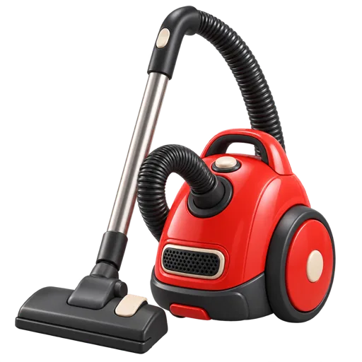 | `cleaning-pest-control.webp` | Cleaning & Pest Control | Hourly service |
| 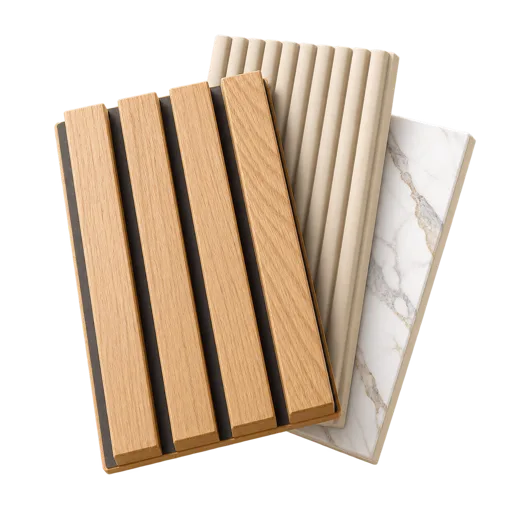 | `wall-panels.webp` | Wall Panels by Revamp | Project service |
|  | `home-painting-upgrade.webp` | Home Painting & Upgrade | Project service |
| 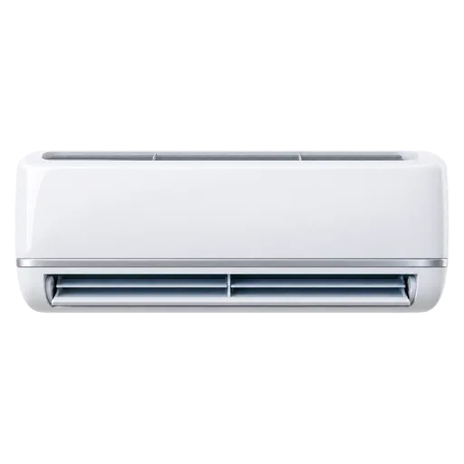 | `ac-appliance-repair.webp` | AC & Appliance Repair | Fixed-price service |
| 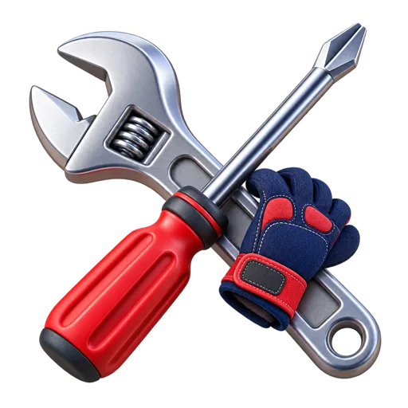 | `trade-services.webp` | Electrician, Plumber & Carpenter | Hourly service |

What each depicts: InstaHelp = smiling housekeeper in a lilac uniform; Women's Salon = woman with towel turban and green face mask; Men's Salon = man in white robe with shaving foam; Cleaning = red canister vacuum; Wall Panels = fluted wood and marble panel samples; Painting = yellow paint roller with a cream stroke; AC = white split AC unit; Trades = crossed spanner and red screwdriver with work gloves.

**To make more in the same style:** "3D render, glossy, soft studio lighting, isolated on transparent background, slight top-down three-quarter view, saturated but soft colours, no text."

---

## 8. Service card photography

Photorealistic lifestyle shots: Indian technicians in **navy uniforms** (gloves where relevant) in bright, warm, modern apartments. 640×640 WebP, displayed `object-fit: cover` with rounded corners. Used on Home rails, hero carousel, and service catalog cards.

| Preview | File | Used for |
|---|---|---|
| 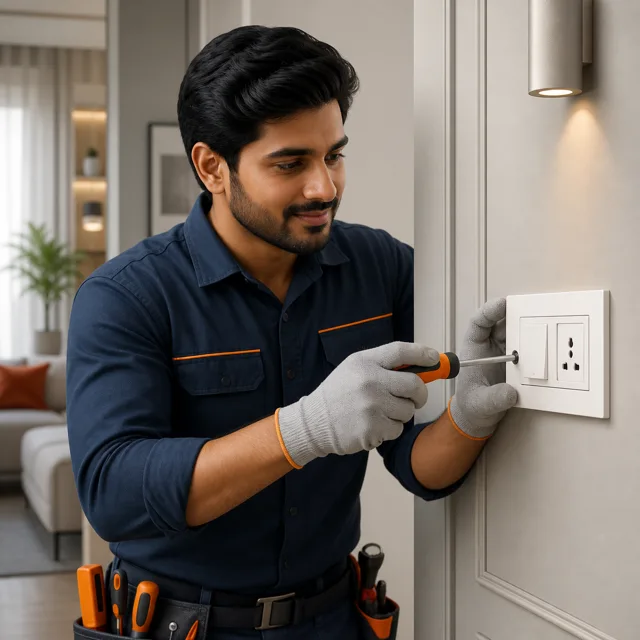 | `electrician.webp` | Electrician (rail + hero slide) |
| 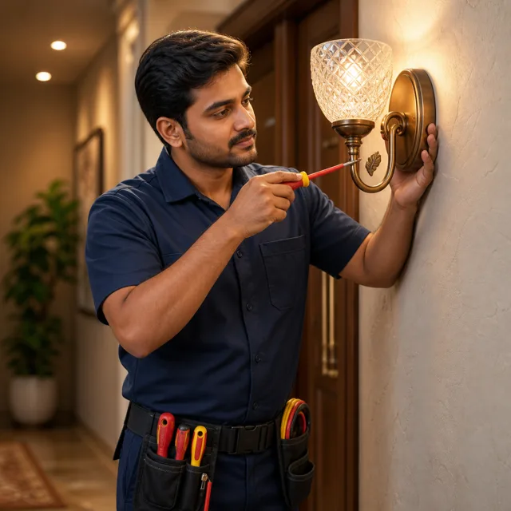 | `electrician-fixture-repair.webp` | Electrician fixture repair |
| 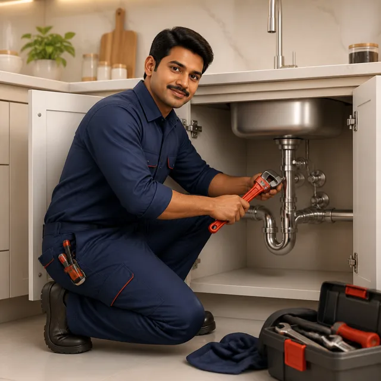 | `plumber.webp` | Plumber |
| 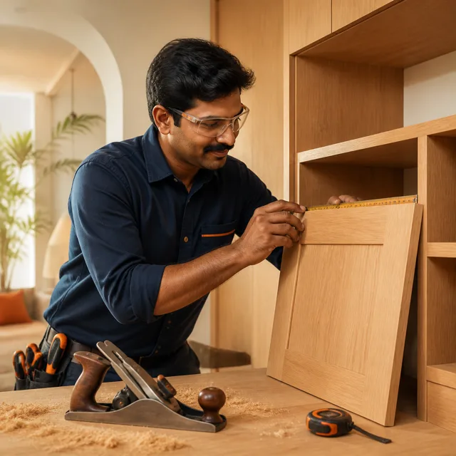 | `carpenter.webp` | Carpenter |
| 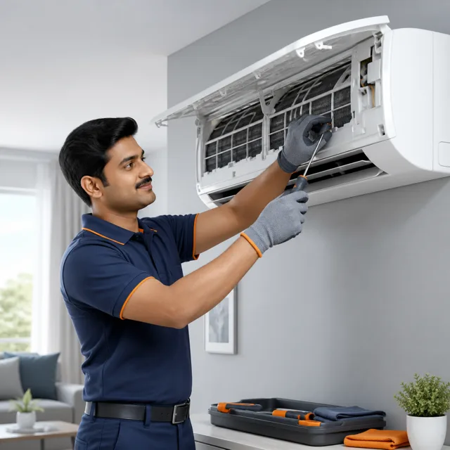 | `ac-service-repair.webp` | AC service & repair / AC Basic Clean |
| 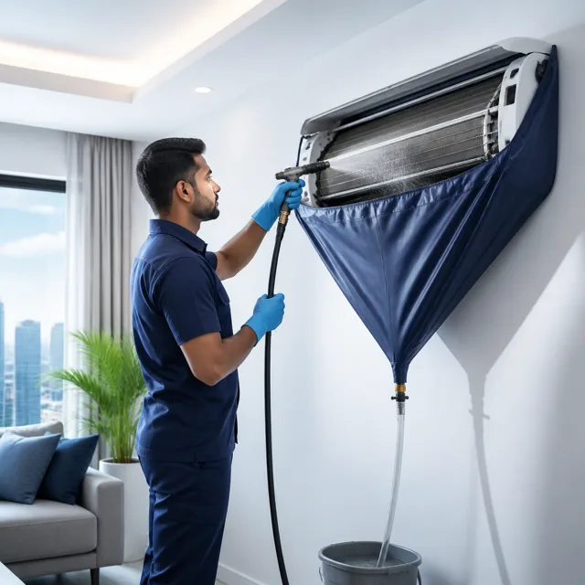 | `ac-deep-clean-warranty.webp` | AC deep clean (with warranty) |
| 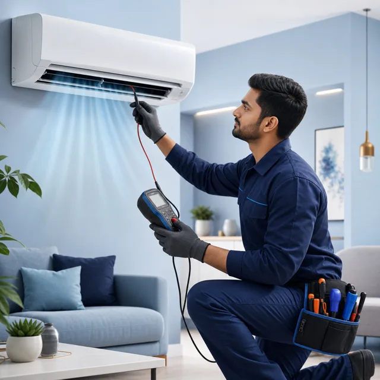 | `ac-diagnostic-repair.webp` | AC diagnostic & repair |
| 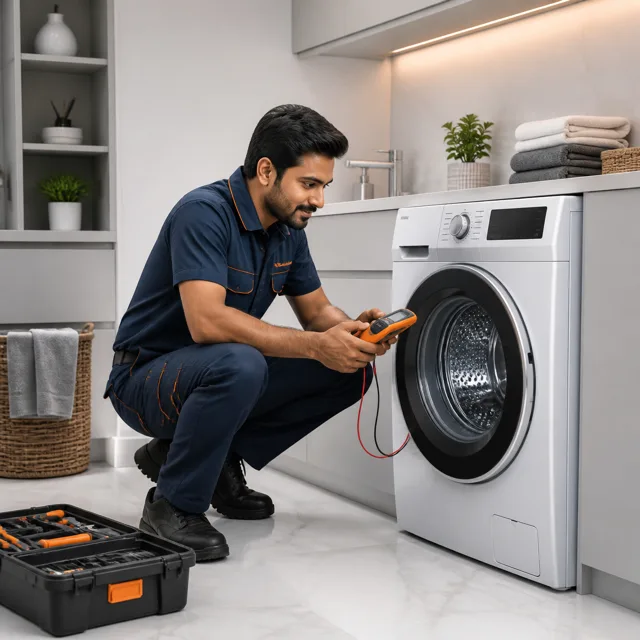 | `appliance-repair.webp` | Appliance (washing machine) repair |
| 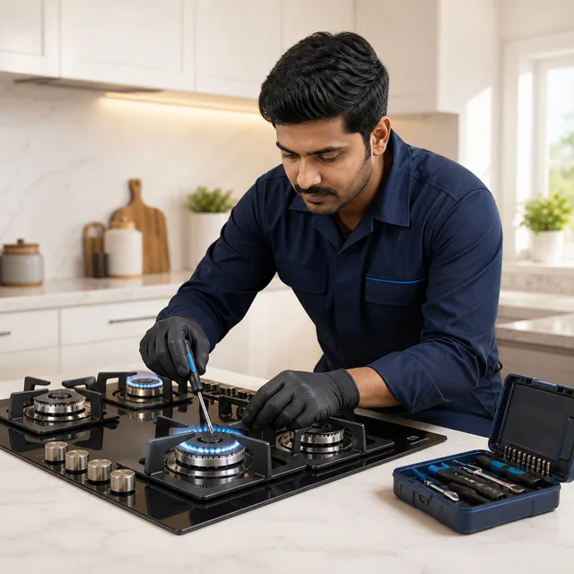 | `stove-repair.webp` | Stove / hob repair |
| 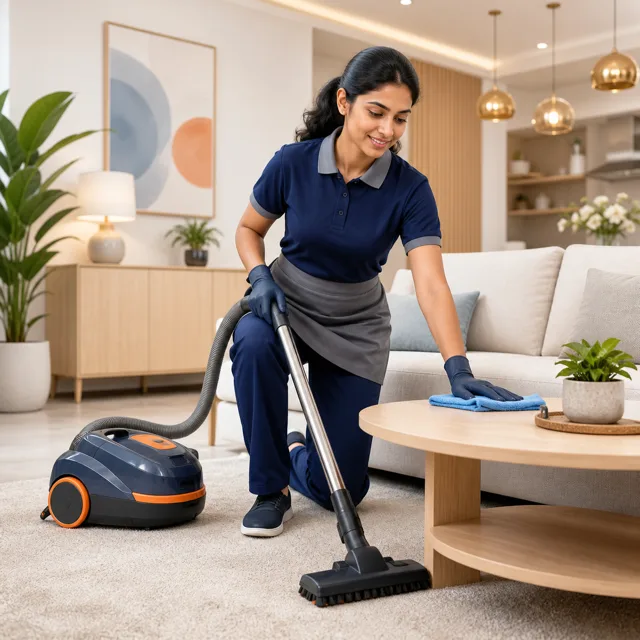 | `deep-cleaning.webp` | Deep cleaning (rail + hero slide) |
| 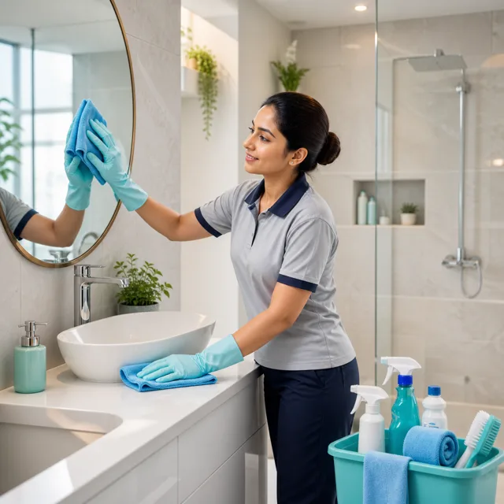 | `bathroom-deep-clean.webp` | Bathroom deep clean |
| 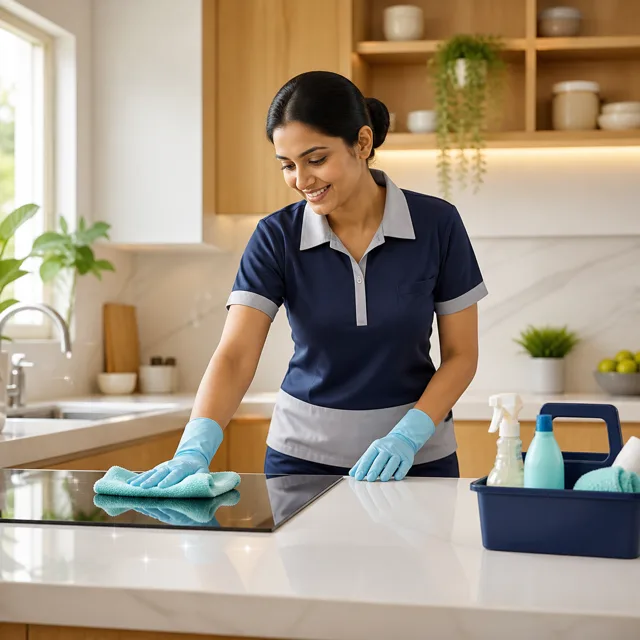 | `kitchen-cleaning.webp` | Kitchen cleaning |
| 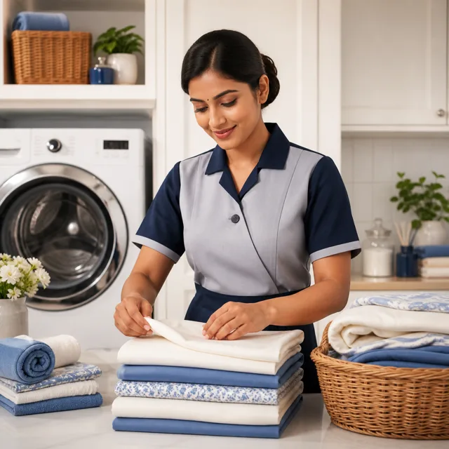 | `fabric-laundry-care.webp` | Fabric & laundry care |
|  | `salon-grooming-premium.webp` | Premium salon grooming |
|  | `mens-salon-grooming.webp` | Men's salon grooming |
| 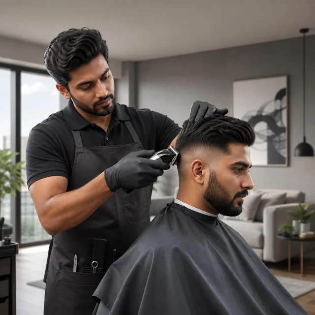 | `mens-haircut.webp` | Men's haircut |
|  | `beard-styling.webp` | Beard styling |
|  | `facial-cleanup.webp` | Facial clean-up |
|  | `deep-tissue-massage.webp` | Deep tissue massage |
| 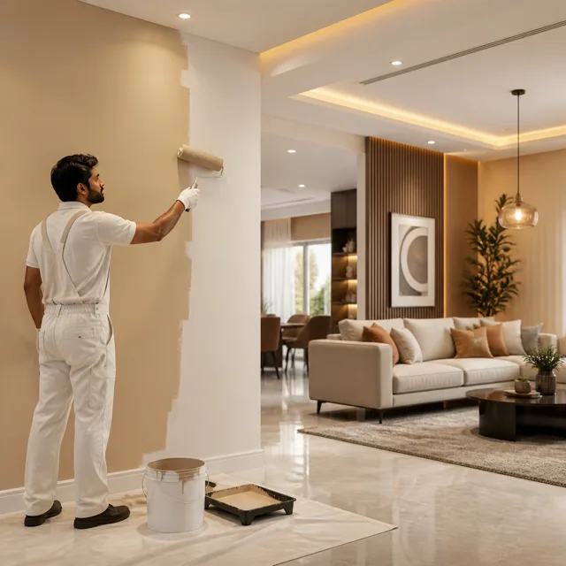 | `painting-renovation.webp` | Painting & renovation (project carousel + hero slide) |
| 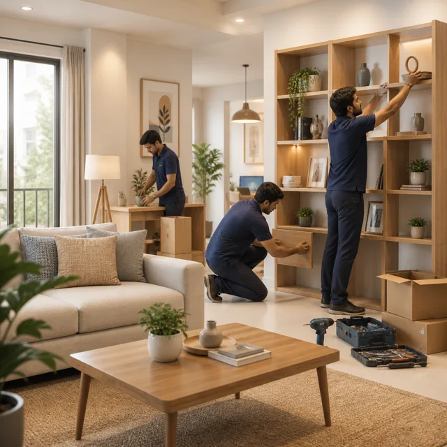 | `new-home-setup.webp` | New home setup (project carousel) |
|  | `waterproofing-civil.webp` | Waterproofing & civil (project carousel) |
| 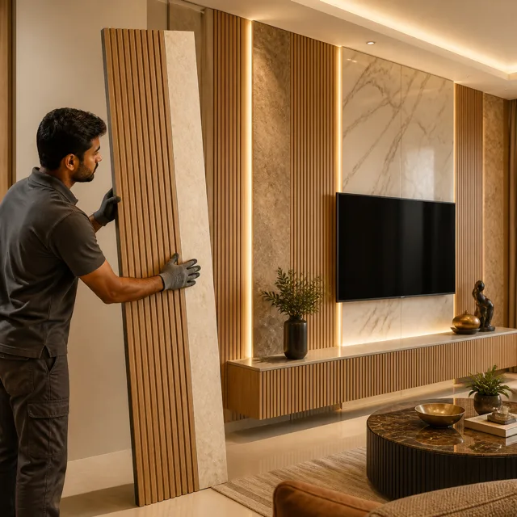 | `wall-panels-revamp.webp` | Wall panels by Revamp |
| 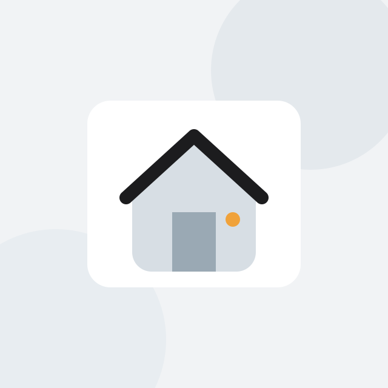 | `placeholder.svg` | Fallback when a service has no image: grey card, house silhouette, `#1C1C1E` roof stroke, orange `#F0A23A` door knob |

---

## 9. Design tokens

### 9.1 Colour (`ZEP`)

The palette is **monochrome (near-black + greys) with one orange accent**, plus Material-style semantic colours.

| Token | Hex | Use |
|---|---|---|
| `primary` | `#1C1C1E` | Buttons, active states, icons, selected borders |
| `primaryDark` | `#000000` | Top of the Home header gradient |
| `primaryLight` | `#F0F0F0` | Selected-chip background, default alert badge |
| `primaryMid` | `#E2E2E2` | Mid grey |
| `accent` | `#E88B1A` | Offers, warnings needing attention, rating label |
| `accentLight` | `#FFF7ED` | Accent tint |
| `bg` | `#F5F5F5` | App background |
| `surface` | `#FFFFFF` | Cards, sheets, headers |
| `border` | `#E0E0E0` | Card / input borders, empty stars |
| `divider` | `#EEEEEE` | Row dividers |
| `inputFill` | `#F0F0F0` | Inputs, icon tiles, unselected pills |
| `text` | `#1A1A1A` | Primary text |
| `textSec` | `#757575` | Secondary text |
| `textHint` | `#9E9E9E` | Hints, placeholders |
| `success` / `successBg` | `#2E7D32` / `#E8F5E9` | Confirmed, verified |
| `warning` / `warningBg` | `#B07000` / `#FFF3CD` | Notes, cautions |
| `error` / `errorBg` | `#C62828` / `#FFEBEE` | Destructive, errors |

Extra one-off colours: star `#FAC775`, rating/warranty `#F5A116`, video red `#E24B4A`, unread notification row `#FAFCFF`, logo orange `#F79532`, placeholder door `#F0A23A`.

### 9.2 Typography

- **Font:** [Plus Jakarta Sans](https://fonts.google.com/specimen/Plus+Jakarta+Sans), weights 400 / 500 / 600 / 700 / 800.
- **Scale (px, by frequency):** 13 (body, most used) · 14 · 11 · 12 · 15 · 10 · 16 · 17 · 12.5 · 11.5 · 18 · 13.5 · 20 · 10.5 · 9.
- **Headings:** screen title 18/700; alert title 17/700; big confirmation 26/800, letter-spacing −0.5; wordmark 24/800.
- **Labels:** bottom-nav 9.5/600; sub-category 10.5/600; pills 13/600.

### 9.3 Radius

| Radius | Use |
|---|---|
| `9999` (pill/circle) | Buttons, pills, avatar/icon circles (most used) |
| 22 | Alert modal |
| 28 | Floating bottom nav |
| 14 | Sub-category tiles, cards |
| 12 | Search bar, option cards |
| 10 | Back button, inputs, rows |
| 8–9 | Time slots, small tiles |
| 5–7 | Tiny chips |

### 9.4 Shadows

| Shadow | Use |
|---|---|
| `0 1px 4px rgba(0,0,0,.05–.06)` | Cards, rows |
| `0 -4px 20px rgba(0,0,0,.08–.10)` | Sticky bottom CTA bars |
| `0 24px 64px rgba(0,0,0,.26)` | Alert modal |
| `0 16px 36px rgba(0,0,0,.16), 0 2px 10px rgba(0,0,0,.08), inset 0 1px 0 rgba(255,255,255,.8)` | Floating glass bottom nav |

---

## 10. Component recipes

**Floating "liquid glass" bottom nav.** Absolute, 16 px from the bottom, 14 px side insets, radius 28, `rgba(255,255,255,.42)` fill, 1 px `rgba(255,255,255,.65)` border. `backdrop-filter: blur(2.5px) url(#displace) blur(5px) brightness(1.08) saturate(1.6)`, where `#displace` is an SVG `feDisplacementMap` filter (a per-channel R/G/B displacement with a little chromatic aberration). The recipe is ported from [nikdelvin/liquid-glass](https://github.com/nikdelvin/liquid-glass) (MIT). Four tabs: Home · Bookings · Property · Offers, each a 20 px icon over a 9.5 px label.

**Home header.** Vertical gradient `#000000 → #1C1C1E`. Row 1: MapPin + address label (16/700 white), full address underneath (11 px white 55%) + ChevronDown; User icon on the right. Row 2: white search bar, radius 12, Search icon in hint grey.

**Standard back header.** White, 1 px bottom border `#E0E0E0`, status bar, then a 36×36 `#F0F0F0` r10 back button + title 18/700.

**Alert modal.** Scrim `rgba(0,0,0,.52)`; card white, radius 22, max-width 320, padding 28/22/22; 66 px tinted icon circle; title 17/700 centred; body 13 px `#757575`, line-height 1.65; two stacked pill buttons (confirm filled with primary / accent / error by variant; cancel white with 1.5 px border).

**Filter pills.** Padding 7×16, pill radius, 13/600. Active: `#1C1C1E` bg with white text. Inactive: `#F0F0F0` bg with `#757575` text. 140 ms transition.

**Trust bar.** A centred row of [12 px icon + 11 px grey text] items with a 16 px gap. Example: ShieldCheck "Verified tech" (green) · Clock "Pay after job" · RotateCcw "Free reschedule".

**Quantity stepper.** 28 px-tall `#1C1C1E` segments with white Minus/Plus (10–13 px) and the count in between.

**Notification row.** 42 px tinted icon tile; unread rows get a `#FAFCFF` background and a 3×38 px primary bar on the left edge.

---

## 11. Gotchas

1. **The icons are Font Awesome Solid, not Lucide**, despite the names and the source comment (see §1).
2. **`strokeWidth` does nothing.** Weight differences you might expect (e.g. active nav tab 2.2 vs 1.8) are not visible; only colour changes.
3. **One broken icon:** the second attachment sheet (`ZepAttachmentSheet`) asks for `Image`, which is not in the map, so "Upload Image/Video" renders a **solid dot** (`fa-circle`). The intended glyph is `fa-image` (map key `ImageIcon`).
4. **Five mapped but unused names:** `Link`, `Lock`, `Receipt`, `Wifi`, `Grid`.
5. **`CheckCircle` and `CheckCircle2` render the same glyph** (`fa-circle-check`).
6. **Leftover blue shadow:** the three "Book a slot / Continue" CTAs on the service screens still use `0 4px 14px rgba(1,89,177,.32)` (from an earlier brand blue, `#0159B1`) on top of today's near-black primary.
7. The logo PNG is blue/gold, but the UI palette is black/grey/orange. They are intentionally different; the logo is only used on splash.

---

## 12. Licences

- **Font Awesome Free 6.4.0:** icons [CC BY 4.0](https://fontawesome.com/license/free), fonts SIL OFL 1.1, code MIT. Free to copy with attribution.
- **Plus Jakarta Sans:** SIL Open Font License 1.1.
- **Liquid-glass filter recipe:** MIT (nikdelvin/liquid-glass).
- **Zepnest logo, wordmark, 3D category illustrations and service photography** in `assets/` are Zepnest's own brand assets. Ask the Zepnest team before reusing them in another product.
